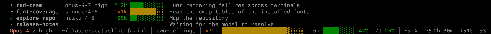

# claude-statusline

A status line for Claude Code built around one number: how close the session is to the
point where the model starts losing the thread.



## Why the gauge is not the context window

Most status lines plot usage against the model's context window, so a 1M window sits at
a comfortable 20% while the answers have already gone vague. Context rot is absolute,
not proportional. Quality degrades somewhere past 200k tokens whether the window holds
200k or a million.

So the gauge measures usage against two ceilings instead. Up to 400k tokens is ordinary
work. From 400k the session is on its last mile, and 500k is the wall. The gauge spans
0 to 500k: green below 400k, yellow on the last mile, red and full from 500k. Its last
fifth is drawn with less air, `▓` over a darker `░`, so the last mile reads at a glance.

Both ceilings are capped by the real window, so they never promise room the window does
not have: on a 200k window the wall sits at 160k (80% of the window, before compaction is
forced on you) and the last mile starts at 128k.

The segment is just the token count and the gauge. The count is rounded down, so it
never shows `400k` before 400k is reached.

## Install

Requires Python 3.7 or later. No dependencies.

The status line is a command. Clone the repository, then point `~/.claude/settings.json`
at it (Claude Code 2.1.153 or later):

```json
{
  "statusLine": {
    "type": "command",
    "command": "python -X utf8 /path/to/claude-statusline/statusline.py",
    "padding": 0,
    "refreshInterval": 10
  }
}
```

On Windows, write the path with forward slashes. Restart Claude Code afterwards; the
setting is not re-read while a session is open.

The subagent rows are a mod. Install it at the prompt of a terminal session, answering
`y` to add the marketplace and then picking a scope:

```
/plugin install the-claude-statusline --marketplace Atlashour/claude-statusline
```

The mod runs the same Python, so the rows need it on `PATH` as `python`, `python3` or
`py`. If your settings still hold a `subagentStatusLine` entry from an earlier version,
remove it: that setting is deprecated in favour of mods, and the mod takes its place.

## The status line

| Segment | Example | Notes |
|---|---|---|
| Model and effort | `Opus 5 medium` | |
| Directory and git | `~/projects/webapp (main* ↑2)` | `*` for uncommitted or untracked changes, `↑` `↓` for commits ahead and behind |
| Session name | `gateway` | Shown once the session is named with `--name` or `/rename`, or gets a generated title |
| Context | `215k`, gauge | Tokens in use against the 400k and 500k ceilings |
| Rate limits | `5h`, gauge, `91% ⟳ 02:26  7d 41%` | Each reset time appears from 85%; the weekly one with its day, `⟳ Mon 14:00` |
| Session | `$9.40  ◷ 2h 30m  +310 −88` | Cost, elapsed time, lines added and removed |

Numbers take your terminal theme's green, yellow and red. Gauges use a darker shade of
the same state so they stay quiet next to the numbers, and the model name is bold in
Claude orange. Rate limits turn yellow at 60% and red at 85%.

The context gauge widens with the terminal, from 10 cells up to 25 at 181 columns, always
a multiple of 5 so the 400k mark falls on a cell edge. From 175 columns the limit that
binds first gets its own gauge: the 5-hour one, or the weekly one on plans without a
5-hour limit, such as a verified Ultra account. Widths depend only on the terminal size, so a gauge never changes length
between refreshes. The line stops 4 columns short of the terminal width, which Claude Code
keeps for its own margins.

The line never wraps. When it runs out of room, segments drop in this order: session
name, lines changed, elapsed time, cost, directory, rate limits. Model and context always
stay. The session name goes first because Claude Code already
shows a name set with `--name` or `/rename` on its prompt bar.

## Subagent rows

The `the-claude-statusline` mod replaces the default rows in the agent panel with rows drawn by
`subagent_statusline.py`. Each row shows a status mark (`▸` running, `·` pending, `◦`
waiting or idle, `✓` done, `✗` failed or stopped), the label, the model and any explicit
effort, the tokens used with the same context gauge as the main line, and the
description. The ceilings are capped by that agent's own window. Columns line up across
rows while the panel is wide enough.

The script runs once per change of the agent list, not once per row, and takes about a
tenth of a second. If Python is missing or the script fails, the panel keeps Claude
Code's own rows.

The gauge appears once the agent's model is known; until then the row shows the token
count alone. Effort appears only when it was set explicitly; no effort means the agent
inherited the session's.

## Tests

```
python -X utf8 test_statusline.py
claude plugin test .
tsc -p . --noEmit
```

The Python suite uses only the standard library, so it runs anywhere the status line
does. It covers line width, colours, the symbols drawn, the subagent rows, and malformed
input, which may drop its own segment but never the line. The plugin suite covers the
mod: one script run per snapshot, and Claude Code's own rows when Python fails. `tsc`
type-checks the mod against the types Claude Code writes into `.claude-plugin/types/`
once it has loaded the mod.

## Details

- Built for dark terminal themes.
- Some symbols, such as `◷` and `⟳`, are missing from many monospace fonts. Each one is
  followed by a space, so a wider fallback glyph cannot overlap the next character.
- `git status` runs at most once every 5 seconds per session.
- `python statusline.py --version` prints the installed version. Bump `VERSION` in
  `statusline.py` and `version` in `.claude-plugin/plugin.json` together whenever
  anything changes; a test holds them equal.

## License

MIT
